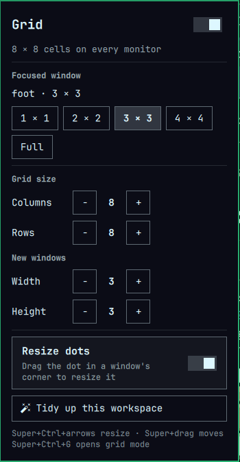

# Matrix Grid

A cell-grid tiling layout and a matrix rain screensaver for
[Omarchy](https://omarchy.org). Windows snap to an adjustable grid (8 × 8 by
default) instead of splitting the screen in halves. Resize a window by dragging
the dot in its corner, move it with Super+drag, and control everything from a
**Grid** panel in the bar. When you step away, blue digital rain fills every
monitor.



## Features

- **Cell-grid tiling.** Each window takes a rectangle of whole cells. New
  windows open at 3 × 3 (adjustable) in the first free spot. When the grid is
  full, rows are added so every window stays visible.
- **Corner resize dots.** A small dot sits in the bottom-right corner of every
  tiled window. Drag it and the grid lights up with an outline and a `4 × 2`
  label showing the size the window will snap to.
- **Super+drag to move.** Drag a window with Super held and it drops onto the
  nearest cells, with the grid shown while you drag.
- **Grid panel in the bar:**
  - Turn the grid on or off. Off falls back to Hyprland's standard
    `dwindle` tiling, and windows return to their cells when you turn it
    back on.
  - Size the focused window in one click: 1 × 1, 2 × 2, 3 × 3, 4 × 4 or Full.
  - Set the grid's columns and rows (2–16) and the size of new windows.
  - Tidy up: pack every window on the workspace toward the top-left, keeping
    its size.
  - Show or hide the resize dots.
  - Start the matrix rain.
- **Matrix rain screensaver.** A seamless 32-second 4K loop of blue digital
  rain plays fullscreen on every monitor. Any key, click or mouse movement
  ends it, and Omarchy's lock and idle handling treat it like the stock
  screensaver.
- **Keyboard control** that leaves text editing alone:

  | Keys | Action |
  |---|---|
  | Super+Ctrl+← → | Shrink / grow width |
  | Super+Ctrl+↑ ↓ | Shrink / grow height |
  | Super+Ctrl+G | Grid mode: arrows move, Shift+arrows resize, 1–4 set sizes, Esc leaves |
  | Super+drag | Move a window to other cells |

Panel settings are saved to `~/.local/state/omarchy/cellgrid-settings.lua` and
survive Hyprland reloads and restarts.

## Requirements

- Omarchy 4 with the Lua Hyprland config (`~/.config/hypr/hyprland.lua`).
- The Omarchy shell (Quickshell).
- `mpv` and `jq` for the screensaver. Omarchy ships both.

It was built and tested on Omarchy 4.0.2, Hyprland 0.56.1 and Quickshell 0.3.1.

## Install

```bash
omarchy plugin add https://github.com/MrSlothuus/matrix.grid.git --enable
~/.config/omarchy/plugins/matrix.grid/install.sh --screensaver
```

The first command installs the shell plugin, which adds the bar panel and the
resize dots. The second command sets up the Hyprland side:

- It links `hypr/cellgrid.lua` to `~/.config/hypr/cellgrid.lua`. If you
  already have a file there, it's moved aside first.
- It adds `require("hypr.cellgrid")` to the end of `hyprland.lua`.
- It reloads Hyprland.

Leave out `--screensaver` if you want the grid only. With it, `install.sh`
also points the idle screensaver at the matrix rain:

- Omarchy's idle service has no setting for which screensaver it runs, so
  `install.sh` clones the service with `omarchy plugin clone omarchy.idle`.
  If you already have a clone, it uses that.
- It then changes the clone's single launch command.

Because the clone is a copy, it won't get future Omarchy changes to idle
handling. `uninstall.sh` restores the command.

To also start the rain from Omarchy's menu, add this to
`~/.config/omarchy/extensions/omarchy-menu.jsonc`:

```jsonc
"system.screensaver": {"label": "Screensaver", "description": "Matrix rain", "action": "~/.config/omarchy/plugins/matrix.grid/screensaver/matrix-rain force"}
```

The Grid button appears in the bar after the workspace numbers. To move it:

```bash
omarchy bar move matrix.grid --section right
```

## Update

```bash
omarchy plugin update matrix.grid
```

`cellgrid.lua` is a link into the plugin folder, so this updates the layout
too. Hyprland picks up the change the next time it reloads (`hyprctl reload`).

## Uninstall

```bash
~/.config/omarchy/plugins/matrix.grid/uninstall.sh
omarchy plugin remove matrix.grid
```

## How it works

| File | Runs in | Does |
|---|---|---|
| `hypr/cellgrid.lua` | Hyprland | Registers the `lua:cellgrid` layout. Places and resizes tiles. Provides the key bindings and Super+drag. Saves settings. |
| `Overlay.qml` | Omarchy shell | Draws the grid during drags and the corner resize dots. |
| `Panel.qml` | Omarchy shell | The bar button and its Grid panel. |
| `screensaver/matrix-rain` | bash | Plays `matrix-rain.mp4` in mpv on every monitor with Omarchy's screensaver app ID. `wake.lua` ends it on input. |

The shell parts talk to the layout through Hyprland's Lua runtime. They read
state with `hyprctl repl 'return require("hypr.cellgrid").settings_json()'`
and make changes with `hyprctl eval`. Hyprland sends no event when a layout
moves windows, so `cellgrid.lua` rewrites
`$XDG_RUNTIME_DIR/cellgrid-layout-changed` after every change. The shell
watches that file to keep the dots and the panel up to date.

To change the defaults used before you've touched the panel, edit the
variables at the top of `hypr/cellgrid.lua`.

## License

MIT, including the matrix rain video.
